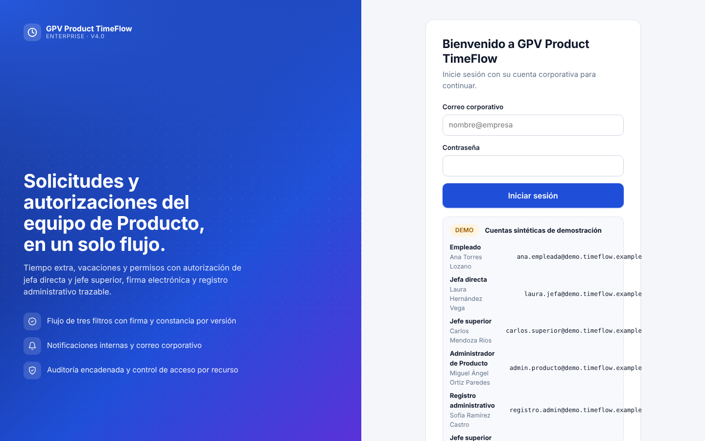
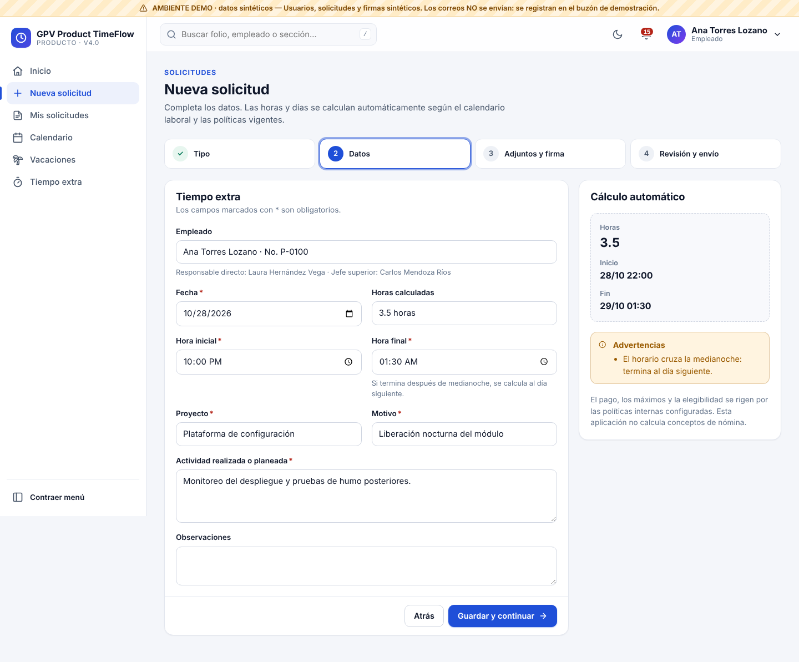
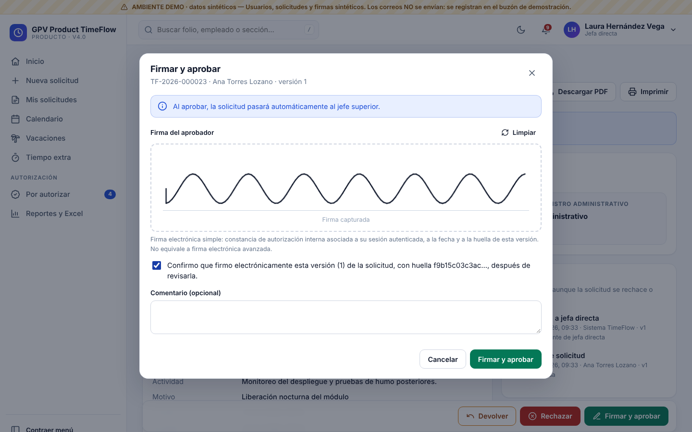

# Manual de usuario · GPV Product TimeFlow

## 1. Acceso

1. Abra la dirección de TimeFlow en Edge, Chrome, Safari o Firefox (computadora, tableta o celular).
2. Pantalla «Bienvenido a GPV Product TimeFlow»: en producción, **Iniciar sesión con Microsoft** (cuenta corporativa); en DEMO, correo y contraseña sintéticos.
3. El inicio muestra «Hola, [su nombre]» y un resumen de su información.

Instalar como aplicación (PWA): en Edge/Chrome use *Instalar aplicación* en la barra de direcciones; en iPhone, *Compartir → Agregar a pantalla de inicio*.

## 2. Navegación

- **Menú lateral** (escritorio; se puede contraer) o **barra inferior** y botón **+** (celular).
- **Buscador global** (arriba): folios, nombres o secciones.
- **Campana**: notificaciones en tiempo real con contador; *Ver historial completo* abre la página de notificaciones.
- **Luna/sol**: tema claro u oscuro.
- La franja amarilla «AMBIENTE DEMO» indica datos de prueba.

## 3. Empleado

### Crear una solicitud (4 pasos)
1. **Tipo**: Tiempo extra, Vacaciones, Permiso con goce o Permiso sin goce.
2. **Datos**: los campos con * son obligatorios. El sistema calcula automáticamente:
   - *Tiempo extra*: horas; si la hora final es menor que la inicial, termina **al día siguiente** (cruce de medianoche). Valida mínimos, máximos por solicitud y por mes, y días hacia atrás permitidos.
   - *Vacaciones*: elija las fechas en el calendario (toque inicio y fin). Se cuentan solo días hábiles (sin fines de semana ni festivos), se muestra el saldo antes y después, y se avisa si compañeros de su equipo estarán ausentes (sin revelar quiénes).
   - *Permisos*: día completo o parcial por horas, clasificación y justificación. Los permisos **sin goce** muestran un aviso: la aplicación no aplica descuentos de nómina.
   - Se detectan duplicados y **traslapes** con sus otras solicitudes.
   Al pulsar **Guardar y continuar** se crea un borrador con folio.
3. **Adjuntos y firma**: PDF, imagen, Word o Excel (10 MB máx.). Firma opcional con dedo, lápiz o mouse.
4. **Revisión y envío**: verifique y pulse **Enviar a jefa directa**. El sistema evita envíos dobles aunque se pulse dos veces.

### Dar seguimiento
- **Mis solicitudes**: filtros por situación (en trámite, devueltas, autorizadas, rechazadas, borradores), tipo y búsqueda.
- **Expediente**: flujo de autorización con los tres filtros, detalle, firmas, adjuntos, historial completo y botones **Ver documento**, **Descargar PDF**, **Imprimir**.
- **Devuelta para corrección**: verá el comentario de quien la devolvió. Pulse **Corregir**, ajuste y **Reenviar**. Las firmas anteriores quedan invalidadas y la solicitud recorre de nuevo los filtros.
- **Cancelar**: posible mientras no exista decisión final del jefe superior.
- **Vacaciones**: disponibles, utilizadas, autorizadas por disfrutar, en trámite, solicitudes y movimientos del saldo.
- **Tiempo extra**: resumen mensual de horas solicitadas, autorizadas, pendientes y rechazadas.
- **Calendario**: sus solicitudes, festivos y ausencias del equipo.

## 4. Jefa directa (filtro 1) y jefe superior (filtro 2)

- **Por autorizar** muestra solo las solicitudes asignadas a su filtro, de la más antigua a la más reciente; las que superan 48 h se marcan **Urgente**.
- En el expediente:
  - **Firmar y aprobar**: dibuje su firma y marque «Confirmo que firmo electrónicamente esta versión…». La firma queda ligada a la versión y huella exactas.
    - La jefa directa turna automáticamente al jefe superior.
    - El jefe superior autoriza en definitiva y remite a registro administrativo (y, en vacaciones, descuenta el saldo una sola vez).
  - **Rechazar**: requiere justificación; la solicitud se detiene y se notifica.
  - **Devolver**: requiere indicar qué corregir.
  - Descargar o imprimir el PDF en cualquier momento.
- Si la solicitud cambió mientras la revisaba, el sistema rechaza la decisión y pide recargar.
- El inicio muestra indicadores del equipo, solicitudes por tipo, tiempo extra acumulado y próximas ausencias. **Calendario → Equipo/Departamento** muestra nombres de su equipo.
- **Reportes y Excel**: exportación de las solicitudes de su equipo.

## 5. Registro administrativo (filtro 3)

Este filtro **no** es una aprobación gerencial y **no puede modificar** las decisiones de los jefes.

1. **Registro administrativo → Pendientes de registro**: solicitudes con las dos autorizaciones.
2. En el expediente revise las dos aprobaciones y las firmas (vigentes, con huella).
3. Acciones:
   - **Marcar como recibida** (acuse).
   - **Registrar observación**: el empleado y el administrador de Producto reciben el aviso.
   - **Registrar**: con referencia administrativa opcional.
   - **Marcar como procesada**: cierra el expediente y envía la confirmación final.
4. **Exportar autorizadas (Excel)** o **Reportes y Excel** para el trámite: archivo con Resumen, Detalle filtrable y Metadatos. Cada exportación queda registrada y no modifica datos.

Si el área no tiene acceso a la aplicación, Producto puede enviar el Excel y los PDF por correo corporativo autorizado; el buzón administrativo recibe aviso de cada autorización final.

## 6. Verificación de documentos

El PDF incluye un **código QR** y una huella SHA-256. Al escanearlo se abre una página pública que indica si el documento corresponde a la versión registrada, sin mostrar datos personales.

## 7. Preguntas frecuentes

- **¿La firma dibujada tiene validez legal de firma avanzada?** No. Es una firma electrónica simple que deja constancia interna de la autorización, ligada a su sesión autenticada y a la versión exacta del documento.
- **¿Puedo saltarme a mi jefa directa?** No. El flujo es obligatorio y lo controla el servidor.
- **¿Por qué no veo la solicitud de otra persona?** Solo puede consultar sus solicitudes y las que le corresponde autorizar.
